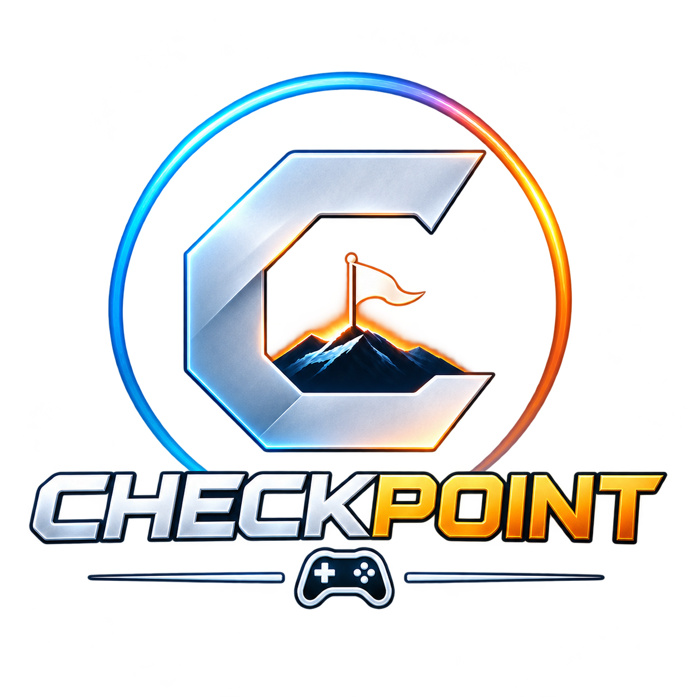
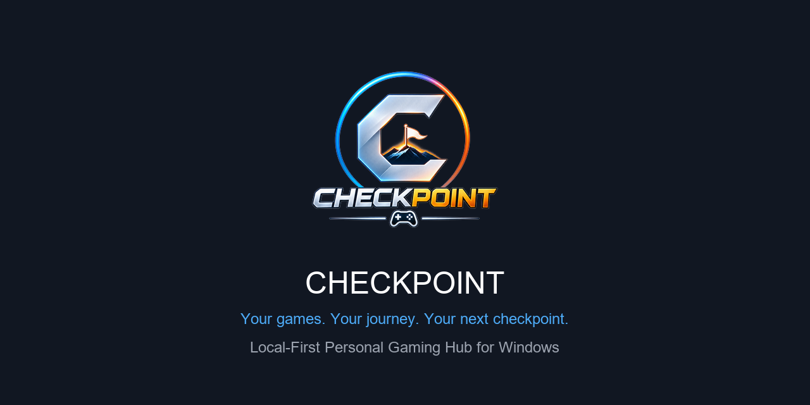
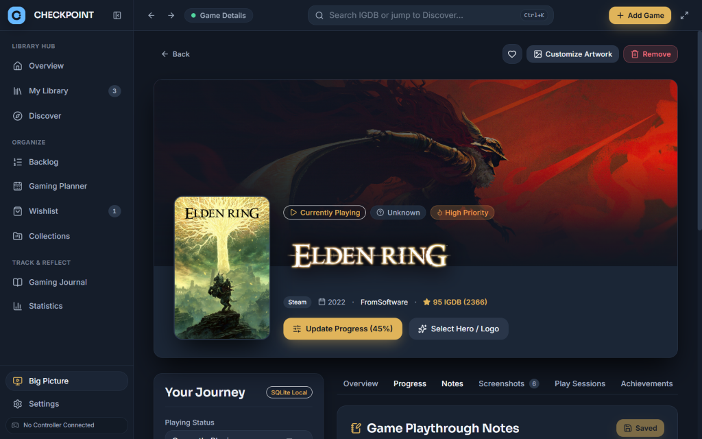
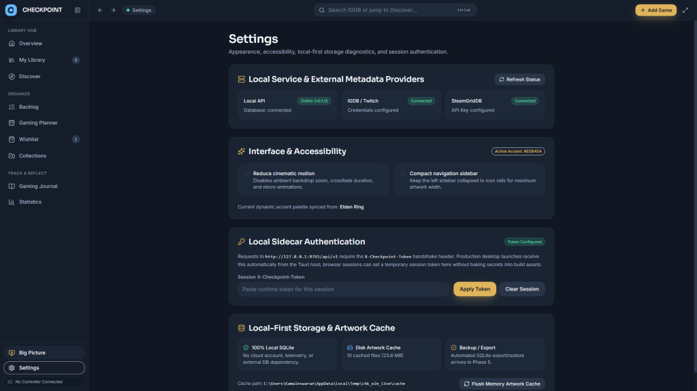
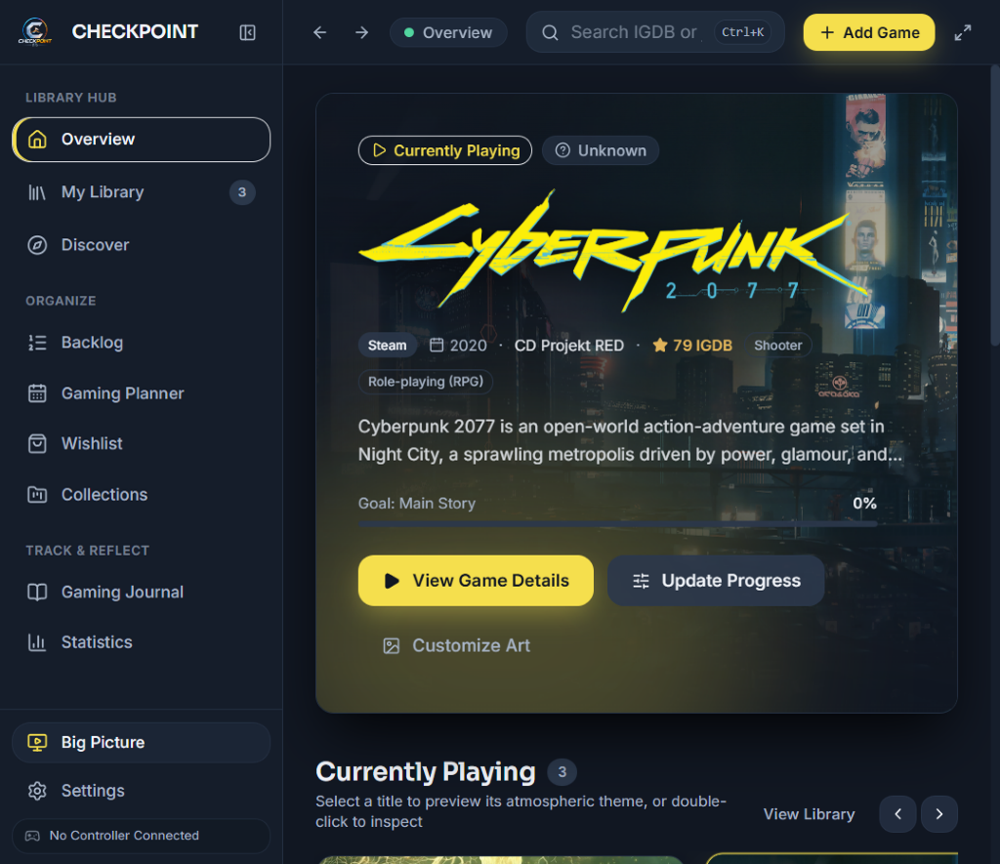
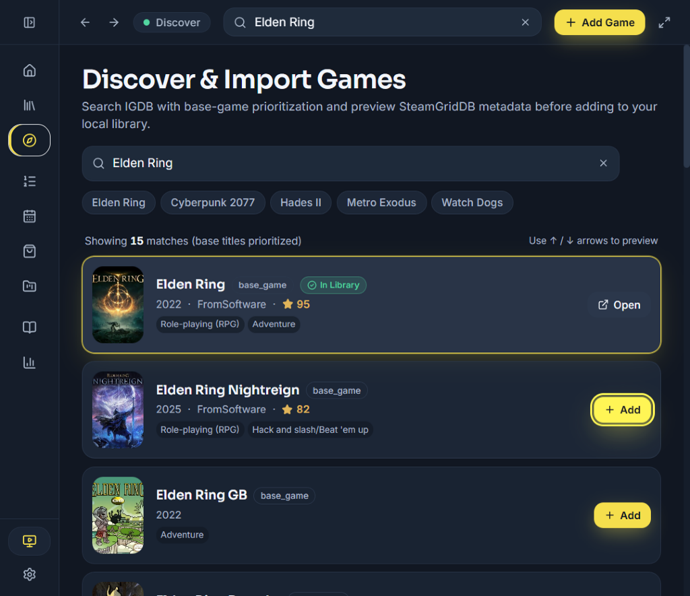
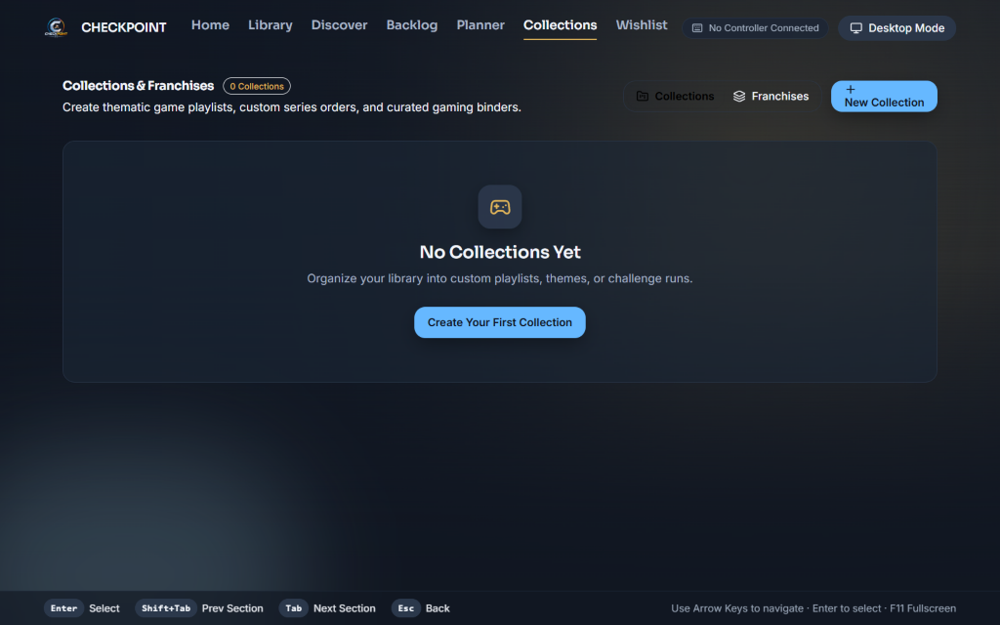
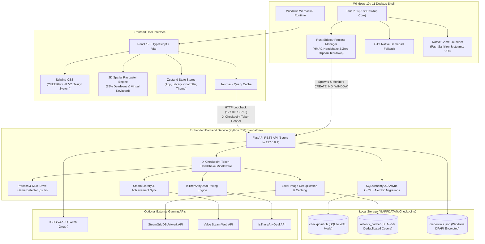

<p align="center">
  
</p>

<h1 align="center">CHECKPOINT Gaming Hub</h1>

<p align="center">
  <strong>Your games. Your journey. Your next checkpoint.</strong>
</p>

<p align="center">
  A cinematic, local-first personal gaming management hub and 10-foot controller launcher for Windows.
  Unify fragmented game libraries across Steam, GOG, Epic Games Store, Ubisoft Connect, EA App, PlayStation, and Xbox into an atmospheric desktop companion with zero cloud lock-in.
</p>

<p align="center">
  <a href="https://github.com/kamalesh-io/checkpoint-gaming-hub/releases/tag/v1.0.0"></a>
  <a href="https://microsoft.com/windows"></a>
  
  
  
  
  
  
</p>

<p align="center">
  <a href="https://github.com/kamalesh-io/checkpoint-gaming-hub/releases/download/v1.0.0/CHECKPOINT_1.0.0_x64-setup.exe"><strong>Download for Windows (.exe)</strong></a> •
  <a href="https://github.com/kamalesh-io/checkpoint-gaming-hub/releases/latest">Latest Release</a> •
  <a href="#installation">Installation Guide</a> •
  <a href="#system-architecture">Architecture</a> •
  <a href="USER_GUIDE.md">User Guide</a> •
  <a href="https://github.com/kamalesh-io/checkpoint-gaming-hub/issues">Report a Bug</a>
</p>

---

<p align="center">
  
</p>

---

## Product Overview

**CHECKPOINT Gaming Hub** is an independent, local-first personal gaming management hub designed for PC gamers who value ownership of their gaming data. Drawing visual and interaction inspiration from **Steam Big Picture Mode**, **PlayStation 5**, **GOG Galaxy**, and **Epic Games Store**, CHECKPOINT acts as a unified command center for your entire gaming collection.

### What CHECKPOINT Does:
* **Unifies Your Library**: Catalog games across Steam, Epic, GOG, EA, Ubisoft, PlayStation, and Xbox in one location.
* **Organizes Your Backlog**: Prioritize what to play next using a ranked queue or visual 4-lane Kanban board.
* **Schedules Gaming Time**: Plan upcoming sessions on a visual calendar with automatic conflict detection.
* **Tracks Real Achievements**: Syncs live Steam achievements, computes global rarity, and protects against story spoilers.
* **Automates Playtime Tracking**: Scans multi-drive Steam installations and monitors running game executables in the background.
* **Launches Installed Games**: Execute titles directly via Steam URIs or custom `.exe` paths with auto-minimization.
* **Monitors Wishlist Deals**: Real-time discount and historical low price tracking powered by IsThereAnyDeal.
* **10-Foot Console Experience**: Seamlessly switch into borderless fullscreen Big Picture Mode with full controller spatial navigation.

> [!NOTE]
> **Independent Application Notice**: CHECKPOINT Gaming Hub is an independent open-source project and is **not affiliated with, endorsed by, or associated with** Valve Corporation, Steam, Epic Games, GOG, Sony Interactive Entertainment, Microsoft, Twitch, or external API providers. All trademarks and game artwork belong to their respective owners.

---

## Visual Tour & Screenshots

Real interface captures from the working CHECKPOINT Gaming Hub application:

| Overview Dashboard | Game Details & Journey |
| :---: | :---: |
|  |  |
| *Atmospheric key art backdrop, dynamic accent tints, and library stats* | *6-tab details view: overview, achievements, sessions, journal, specs* |

| Big Picture Mode (10-Foot UI) | Controller Navigation & Spatial Focus |
| :---: | :---: |
|  |  |
| *Full 10-foot television interface with dynamic spotlight carousel* | *2D geometric spatial raycasting and context-aware glyph legends* |

<p align="center">
  <strong>Gaming Management Suite</strong><br />
  <br />
  <em>Ranked backlog queue, 4-lane Kanban board, and play session tracking</em>
</p>

---

## Core Feature Breakdown

### 🎮 Game Library
* **Global Catalog Search**: Fast game discovery via IGDB v4 with base-game prioritization over DLCs/editions.
* **High-Res SteamGridDB Artwork**: Automatic downloading and local caching of 2:3 portrait covers, 16:9 hero banners, and transparent logos.
* **In-App Artwork Selector**: Easily switch covers and hero backdrops with community artwork directly inside the app.
* **Decoupled Status Architecture**: Independent tracking of **Playing Status** (*Planned, Playing, On Hold, Completed, 100%, Dropped*) and **Ownership Status** (*Owned, Subscription, Family Shared, Wishlist*).
* **Franchise Grouping**: Group games by franchise with custom play sequence ordering.
* **100% Offline Access**: All imported game metadata and cached artwork remain accessible offline without internet access.

### 📋 Gaming Management
* **Ranked Backlog Queue**: Drag-and-drop or use controller Up/Down buttons to reorder your queue. Includes a "Set as Next Game" shortcut.
* **4-Lane Kanban Board**: Visual workflow lanes (*Planned*, *Now Playing*, *On Hold*, *Completed*).
* **Gaming Planner & Calendar**: Schedule gaming sessions with friends, recurring events, and overlap alerts.
* **Gaming Journal & Notes**: Rich markdown notes for playthrough milestones, respec notes, and ratings with click-to-reveal spoiler protection.
* **Session Recovery**: Automatically detects unfinalized play sessions upon restart and prompts you to confirm elapsed time.

### ☁️ Steam Integration
* **Steam Account Linking**: Connect via Steam ID64 or vanity profile URL with profile visibility diagnostics.
* **3-Category Import Preview**: Preview games before import categorized into *New Games*, *Existing in Library*, and *Unmatched*.
* **Selective Batch Import**: Selectively import titles with real-time progress indicators.
* **Live Steam Achievements**: Syncs player achievements, global unlock percentages, rarity tiers, and secret blur.
* **100% Completion Suggestion**: Congratulates you upon unlocking all achievements and suggests marking the game 100% completed.
* **Decoupled Playtime**: Preserves user-entered manual hours while tracking official Steam playtime separately.

### ⚡ Automation & Game Launcher
* **Multi-Drive VDF Scanner**: Parses `libraryfolders.vdf` across all storage drives to discover installed Steam games.
* **ACF Manifest Parser**: Reads `appmanifest_{appid}.acf` for install states, directories, and build IDs.
* **Background Process Detection**: Polls running executables using `psutil` with an extensive exclusion list filtering out anti-cheat, crash handlers, and launchers.
* **Native Desktop Launcher**: Launches Steam games via `steam://rungameid/<id>` and custom game `.exe` files with command-line arguments.
* **Auto Window Management**: Optionally minimizes CHECKPOINT to the taskbar upon game launch and restores the window when exiting.

### 📺 Cinematic 10-Foot Experience
* **Big Picture Mode**: Borderless fullscreen console interface designed for 1080p and 4K television screens.
* **Atmospheric Dual-Direction Scrims**: Dynamic key art transitions dynamically shift background backdrops and primary accent colors (`#111722` to `#2B384B`).
* **Universal Controller Engine**: 2D geometric spatial raycaster with 15% radial deadzone normalization and stick drift resistance.
* **Context-Aware Glyphs**: Automatically detects connected Xbox and PlayStation DualSense controllers to display matching SVG glyphs.
* **On-Screen Virtual Keyboard (OSK)**: Full controller typing modal for search and text input in Big Picture Mode.

### 💰 Wishlist & Honest Statistics
* **Regional Price Intelligence**: Powered by IsThereAnyDeal with support for Indian Rupee (INR) and localized currencies.
* **Deals & Historical Lows**: Tracks real-time discounts, flags all-time historical lows, and triggers target met alerts.
* **365-Day Activity Heatmap**: Visual contribution-style grid displaying daily gaming activity over the past year.
* **Honest Genre Analytics**: Transparently documents multi-genre distribution without inflating total hours played.

### 🔒 Privacy & Local-First Storage
* **SQLite with WAL Mode**: Embedded database storage in `%APPDATA%\Checkpoint\checkpoint.db`. Zero cloud databases.
* **Windows DPAPI Encryption**: API keys and tokens are encrypted locally using Windows Data Protection API in `credentials.json`.
* **Zero Remote Telemetry**: No analytics, tracking beacons, or third-party usage monitoring.
* **Online SQLite Backups**: Non-blocking database snapshot backups and one-click safety restorations.

---

## System Architecture

CHECKPOINT follows a local-first monorepo architecture:



---

## Installation

### For Windows Users (Standard Installation)

1. Download the latest installer from GitHub Releases:
   * **Recommended**: [CHECKPOINT_1.0.0_x64-setup.exe](https://github.com/kamalesh-io/checkpoint-gaming-hub/releases/download/v1.0.0/CHECKPOINT_1.0.0_x64-setup.exe) (NSIS Setup, ~34 MB)
   * **Alternative**: [CHECKPOINT_1.0.0_x64_en-US.msi](https://github.com/kamalesh-io/checkpoint-gaming-hub/releases/download/v1.0.0/CHECKPOINT_1.0.0_x64_en-US.msi) (Windows Installer, ~35 MB)
2. Run the downloaded installer.
3. If **Windows SmartScreen** appears, click **"More info"** $\rightarrow$ **"Run anyway"**.
4. The installer automatically installs CHECKPOINT to your local user directory without requiring administrator privileges.
5. Launch **CHECKPOINT Gaming Hub** from your Start Menu or Desktop.

> [!IMPORTANT]
> **No Developer Tools Required**: The distributed installer is 100% self-contained. You do **not** need Python, Node.js, Rust, Uvicorn, or any development dependencies installed on your computer.

### System Requirements
* **Operating System**: Windows 10 (Version 1903 / Build 18362 or later) or Windows 11 (64-bit).
* **Runtime**: Microsoft Edge WebView2 Evergreen Runtime (pre-installed on Windows 10/11).
* **Storage**: ~150 MB free disk space for application files; additional disk space for cached game artwork in `%APPDATA%\Checkpoint\`.
* **RAM**: Minimum 4 GB RAM (CHECKPOINT uses ~100–120 MB total memory during operation).
* **Input**: Keyboard & Mouse, or standard XInput / DirectInput gamepad (Xbox One/Series, PlayStation DualShock 4 / DualSense).

### Code Signing Notice
CHECKPOINT Gaming Hub is an open-source hobby project and is **not signed with a paid commercial Extended Validation (EV) certificate**. Windows SmartScreen may display an *"Unknown Publisher"* warning on initial download until community reputation builds. The source code is open for audit and verified free of telemetry or malware.

---

## API Configuration

To enable game search, artwork downloading, and optional price tracking, enter your free API keys in **Settings** $\rightarrow$ **Integrations**:

| Provider | Purpose | Status | Setup Link |
| :--- | :--- | :--- | :--- |
| **Twitch / IGDB** | Global game search, descriptions, genres, release dates | **Required for Search** | [Twitch Developer Console](https://dev.twitch.tv/console/apps) |
| **SteamGridDB** | High-res 2:3 covers, 16:9 banners, logos, community art | **Recommended** | [SteamGridDB API](https://www.steamgriddb.com/profile/preferences/api) |
| **Steam Web API** | Steam library sync, playtime, live achievement tracking | **Optional** | [Steam Community API Key](https://steamcommunity.com/dev/apikey) |
| **IsThereAnyDeal** | Digital store discounts and historical low price alerts | **Optional** | [IsThereAnyDeal](https://isthereanydeal.com) |

*All entered API keys are encrypted locally using Windows DPAPI in `%APPDATA%\Checkpoint\credentials.json`.*

---

## Verification & Test Results

The V1.0.0 release has been thoroughly tested against an automated test suite:

```
================================== TEST SUMMARY ==================================
✔ Backend Unit & Integration Tests (pytest):   29 / 29 PASSED (100% Green)
✔ Frontend Unit Tests (Node test runner):        9 / 9 PASSED (100% Green)
✔ Rust Shell & IPC Tests (cargo test):          4 / 4 PASSED (100% Green)
✔ TypeScript Strict Type Check (tsc -b):        0 Errors
✔ ESLint Code Quality Analysis:                 0 Errors, 0 Warnings
✔ Production Frontend Build (vite build):       SUCCESS (Built in 5.07s)
✔ Standalone Python Sidecar (PyInstaller):      SUCCESS (30.47 MB packaged)
✔ Windows Release Bundling (Tauri NSIS + MSI):  SUCCESS (33.62 MiB NSIS / 34.46 MiB MSI)
✔ Database Schema Migrations (Alembic):         Up to date (Revision b2c3d4e5f6g7)
==================================================================================
```

> [!NOTE]
> **Controller Testing Disclosure**: Gamepad navigation, deadzone normalization, OSK typing, and button glyphs were validated using synthetic W3C Gamepad API test suites and Rust `gilrs` input compilation. Physical USB/Bluetooth controller behavior remains subject to individual hardware device profiles.

---

## Developer Setup

If you want to build or contribute to CHECKPOINT Gaming Hub from source:

### 1. Prerequisites
* **Windows 10 / 11 (x64)**
* **Node.js**: v20.x or later + `npm`
* **Python**: v3.11 or v3.12
* **Rust**: v1.75+ with the MSVC toolchain (`x86_64-pc-windows-msvc`)
* **Visual Studio 2022 C++ Build Tools**

### 2. Clone the Repository
```powershell
git clone https://github.com/kamalesh-io/checkpoint-gaming-hub.git
cd checkpoint-gaming-hub
```

### 3. Backend Setup
```powershell
cd backend
python -m venv .venv
.\.venv\Scripts\Activate.ps1
pip install -r requirements.txt
cp .env.example .env
# Edit .env with your IGDB and SteamGridDB keys
alembic upgrade head
uvicorn app.main:app --port 8765 --reload
```

### 4. Frontend Setup
```powershell
cd ../frontend
npm install
npm run dev
```

### 5. Running Full Desktop App
```powershell
# From repository root
cargo tauri dev
```

### 6. Building Production Installer
```powershell
# 1. Package the Python sidecar binary
.\backend\.venv\Scripts\python.exe backend\build_sidecar.py

# 2. Build the Tauri release bundle
npm --prefix frontend run tauri:build
```
*Generated installers are located in `src-tauri/target/release/bundle/nsis/` and `src-tauri/target/release/bundle/msi/`.*

---

## Documentation Index

Detailed architectural and engineering documentation is available:

* [PRD.md](docs/PRD.md) — Comprehensive product requirements, user personas, and scoping.
* [ARCHITECTURE.md](docs/ARCHITECTURE.md) — High-level architecture, monorepo layout, process lifecycle, and security model.
* [DESIGN.md](docs/DESIGN.md) — Stitch V2 visual source of truth, design tokens, typography scales, and wireframes.
* [DATABASE.md](docs/DATABASE.md) — Normalized SQLite schema, ER diagrams, WAL configuration, and Alembic migrations.
* [API.md](docs/API.md) — REST API endpoints, schemas, authentication handshake, and external API integrations.
* [CONTROLLER.md](docs/CONTROLLER.md) — 2D spatial navigation engine, deadzone math, controller glyphs, and OSK.
* [SECURITY.md](SECURITY.md) — Security policy, local-first architecture, and vulnerability reporting.
* [USER_GUIDE.md](USER_GUIDE.md) — Complete 14-section end-user manual and troubleshooting guide.
* [CHANGELOG.md](CHANGELOG.md) — Detailed version history adhering to Keep a Changelog.
* [RELEASE_NOTES.md](RELEASE_NOTES.md) — Release highlights for V1.0.0 "First Light".
* [CONTRIBUTING.md](CONTRIBUTING.md) — Contribution guidelines, code style, and PR requirements.

---

## Known Limitations & Considerations

1. **Steam Profile Privacy**: Steam library synchronization and achievement tracking require your Steam profile and game details to be set to **Public** in Steam Community privacy settings.
2. **Steam Family Sharing**: Steam Web API does not expose a distinct family-share ownership flag; CHECKPOINT provides manual ownership tagging (*Family Shared*) to prevent data distortion.
3. **Hardware Controller Detection**: While tested against standard Xbox and PlayStation DualSense controller schemas via W3C Gamepad API and `gilrs`, non-standard third-party direct-input controllers may require third-party XInput mappers.
4. **Desktop Notifications**: Background notifications require CHECKPOINT to be running or minimized in the taskbar; closed applications cannot push system notifications on Windows without background services.
5. **Authenticode Signing**: Unsigned installer binary may trigger initial Windows SmartScreen warnings on first launch.

---

## Credits & Attribution

* **IGDB by Twitch**: Game metadata, descriptions, genres, and release information.
* **SteamGridDB**: High-resolution community game covers, hero banners, and logos.
* **Valve Corporation**: Steam Web API, Steam Community services, and Steam client URI protocol.
* **IsThereAnyDeal**: Digital game store pricing, deals, and discount data.
* **Google Stitch**: Visual design tokens and UI/UX design specifications.
* **Tauri Framework & Community**: High-performance, lightweight Rust desktop application framework.
* **FastAPI & Uvicorn**: High-performance Python backend service.
* **React, Tailwind CSS, & Lucide**: Modern, responsive frontend interface components.

---

## License

Proprietary / License Selection Pending.  
*All rights reserved by the repository owner. An open-source license will be selected and published in an upcoming release.*

---

<p align="center">
  <strong>CHECKPOINT Gaming Hub</strong><br />
  <em>Your games. Your journey. Your next checkpoint.</em><br />
  Built for gamers who want to spend less time managing their games and more time playing them.
</p>
