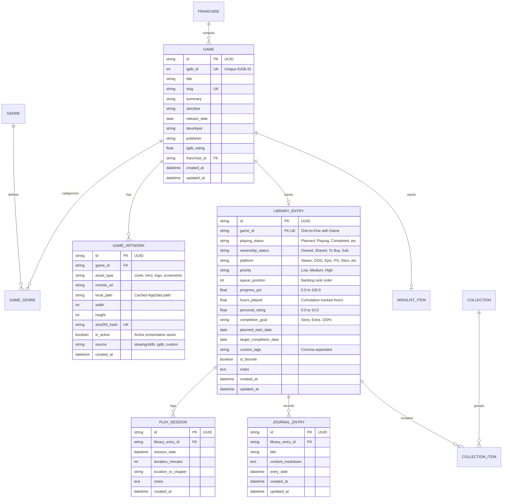

# CHECKPOINT Gaming Hub — Database Schema & Migration Specification

**Document Version:** 1.0.0  
**Storage Engine:** SQLite 3 (Async via `aiosqlite` & SQLAlchemy 2.0)  
**Database Path:** `%APPDATA%/Checkpoint/checkpoint.db`  
**Migration Framework:** Alembic  

---

## 1. SQLite Engine Configuration & PRAGMA Settings

To support low-latency local desktop access, non-blocking reads during background artwork caching, and complete data safety, every SQLite connection initializes with the following PRAGMAs:

```sql
-- Write-Ahead Logging for concurrent readers and a single async writer
PRAGMA journal_mode = WAL;

-- Safe durability balance on modern SSDs without fsync micro-stutters
PRAGMA synchronous = NORMAL;

-- Enforce strict relational integrity
PRAGMA foreign_keys = ON;

-- 64MB memory cache for rapid library filtering and catalog lookups
PRAGMA cache_size = -64000;

-- In-memory temporary tables and indexes
PRAGMA temp_store = MEMORY;

-- Increase busy timeout to 5 seconds to gracefully handle background writes
PRAGMA busy_timeout = 5000;
```

---

## 2. Entity-Relationship Diagram



---

## 3. Detailed Table Specifications (DDL)

### 3.1 `games` (Global Registry of Imported Games)
Stores canonical game metadata imported from IGDB.

```sql
CREATE TABLE games (
    id VARCHAR(36) PRIMARY KEY,
    igdb_id INTEGER UNIQUE NOT NULL,
    title VARCHAR(255) NOT NULL,
    slug VARCHAR(255) UNIQUE NOT NULL,
    summary TEXT,
    storyline TEXT,
    release_date DATE,
    developer VARCHAR(255),
    publisher VARCHAR(255),
    igdb_rating REAL,
    franchise_id VARCHAR(36) REFERENCES franchises(id) ON DELETE SET NULL,
    created_at DATETIME NOT NULL DEFAULT CURRENT_TIMESTAMP,
    updated_at DATETIME NOT NULL DEFAULT CURRENT_TIMESTAMP
);

CREATE INDEX idx_games_title ON games(title);
CREATE INDEX idx_games_slug ON games(slug);
CREATE INDEX idx_games_igdb_id ON games(igdb_id);
```

### 3.2 `library_entries` (User's Personal Library Instances)
Decoupled tracking representing personal user relationship to a game.

```sql
CREATE TABLE library_entries (
    id VARCHAR(36) PRIMARY KEY,
    game_id VARCHAR(36) UNIQUE NOT NULL REFERENCES games(id) ON DELETE CASCADE,
    playing_status VARCHAR(32) NOT NULL DEFAULT 'Planned',
    ownership_status VARCHAR(32) NOT NULL DEFAULT 'Owned',
    platform VARCHAR(32) NOT NULL DEFAULT 'Steam',
    priority VARCHAR(16) NOT NULL DEFAULT 'Medium',
    queue_position INTEGER DEFAULT 0,
    progress_pct REAL NOT NULL DEFAULT 0.0 CHECK (progress_pct >= 0.0 AND progress_pct <= 100.0),
    hours_played REAL NOT NULL DEFAULT 0.0 CHECK (hours_played >= 0.0),
    personal_rating REAL CHECK (personal_rating >= 0.0 AND personal_rating <= 10.0),
    completion_goal VARCHAR(32) NOT NULL DEFAULT 'Main Story',
    planned_start_date DATE,
    target_completion_date DATE,
    custom_tags TEXT DEFAULT '',
    is_favorite BOOLEAN NOT NULL DEFAULT 0,
    notes TEXT DEFAULT '',
    created_at DATETIME NOT NULL DEFAULT CURRENT_TIMESTAMP,
    updated_at DATETIME NOT NULL DEFAULT CURRENT_TIMESTAMP,
    
    -- Status constraints
    CHECK (playing_status IN ('Planned', 'Currently Playing', 'On Hold', 'Completed', '100% Completed', 'Dropped')),
    CHECK (ownership_status IN ('Owned', 'Family Shared', 'To Buy', 'Subscription')),
    CHECK (priority IN ('Low', 'Medium', 'High')),
    CHECK (completion_goal IN ('Main Story', 'Main + Side Quests', '100% Completion'))
);

CREATE INDEX idx_lib_playing_status ON library_entries(playing_status);
CREATE INDEX idx_lib_ownership_status ON library_entries(ownership_status);
CREATE INDEX idx_lib_platform ON library_entries(platform);
CREATE INDEX idx_lib_priority ON library_entries(priority);
CREATE INDEX idx_lib_queue_position ON library_entries(queue_position);
CREATE INDEX idx_lib_is_favorite ON library_entries(is_favorite);
```

### 3.3 `game_artworks` (Cached Images & SteamGridDB Assets)
Manages portrait covers, landscape hero backdrops, transparent logos, and screenshots.

```sql
CREATE TABLE game_artworks (
    id VARCHAR(36) PRIMARY KEY,
    game_id VARCHAR(36) NOT NULL REFERENCES games(id) ON DELETE CASCADE,
    asset_type VARCHAR(24) NOT NULL CHECK (asset_type IN ('cover', 'hero', 'logo', 'screenshot')),
    remote_url TEXT NOT NULL,
    local_path TEXT NOT NULL,
    width INTEGER,
    height INTEGER,
    sha256_hash VARCHAR(64) UNIQUE NOT NULL,
    is_active BOOLEAN NOT NULL DEFAULT 1,
    source VARCHAR(32) NOT NULL DEFAULT 'steamgriddb',
    created_at DATETIME NOT NULL DEFAULT CURRENT_TIMESTAMP
);

CREATE INDEX idx_artwork_game_type ON game_artworks(game_id, asset_type, is_active);
CREATE INDEX idx_artwork_sha256 ON game_artworks(sha256_hash);
```

### 3.4 `play_sessions` (Manual Session History)
Records individual play sessions with time logs, milestone descriptions, and locations.

```sql
CREATE TABLE play_sessions (
    id VARCHAR(36) PRIMARY KEY,
    library_entry_id VARCHAR(36) NOT NULL REFERENCES library_entries(id) ON DELETE CASCADE,
    session_date DATETIME NOT NULL DEFAULT CURRENT_TIMESTAMP,
    duration_minutes INTEGER NOT NULL CHECK (duration_minutes > 0),
    location_or_chapter VARCHAR(255),
    notes TEXT,
    created_at DATETIME NOT NULL DEFAULT CURRENT_TIMESTAMP
);

CREATE INDEX idx_sessions_entry ON play_sessions(library_entry_id, session_date DESC);
```

### 3.5 `journal_entries` (Game-Specific Journal Notes)
Rich markdown notes, build logs, and boss strategies.

```sql
CREATE TABLE journal_entries (
    id VARCHAR(36) PRIMARY KEY,
    library_entry_id VARCHAR(36) NOT NULL REFERENCES library_entries(id) ON DELETE CASCADE,
    title VARCHAR(255) NOT NULL,
    content_markdown TEXT NOT NULL,
    entry_date DATETIME NOT NULL DEFAULT CURRENT_TIMESTAMP,
    created_at DATETIME NOT NULL DEFAULT CURRENT_TIMESTAMP,
    updated_at DATETIME NOT NULL DEFAULT CURRENT_TIMESTAMP
);

CREATE INDEX idx_journal_entry_date ON journal_entries(library_entry_id, entry_date DESC);
```

### 3.6 `franchises` (Series Groupings)
Facilitates grouping titles within an overarching narrative universe.

```sql
CREATE TABLE franchises (
    id VARCHAR(36) PRIMARY KEY,
    name VARCHAR(255) UNIQUE NOT NULL,
    slug VARCHAR(255) UNIQUE NOT NULL,
    description TEXT,
    created_at DATETIME NOT NULL DEFAULT CURRENT_TIMESTAMP
);
```

### 3.7 `collections` & `collection_items` (Custom User Groupings)
Custom playlists and groupings (e.g., "Soulslike Classics", "Winter Backlog 2026").

```sql
CREATE TABLE collections (
    id VARCHAR(36) PRIMARY KEY,
    name VARCHAR(255) NOT NULL,
    description TEXT,
    is_pinned BOOLEAN NOT NULL DEFAULT 0,
    created_at DATETIME NOT NULL DEFAULT CURRENT_TIMESTAMP
);

CREATE TABLE collection_items (
    collection_id VARCHAR(36) NOT NULL REFERENCES collections(id) ON DELETE CASCADE,
    library_entry_id VARCHAR(36) NOT NULL REFERENCES library_entries(id) ON DELETE CASCADE,
    display_order INTEGER NOT NULL DEFAULT 0,
    PRIMARY KEY (collection_id, library_entry_id)
);
```

### 3.8 `wishlist_items` (Unowned Games Tracked for Purchase)
Unowned games being monitored with purchase intent.

```sql
CREATE TABLE wishlist_items (
    id VARCHAR(36) PRIMARY KEY,
    game_id VARCHAR(36) UNIQUE NOT NULL REFERENCES games(id) ON DELETE CASCADE,
    priority VARCHAR(16) NOT NULL DEFAULT 'Medium' CHECK (priority IN ('Low', 'Medium', 'High')),
    target_price REAL,
    store_preference VARCHAR(32) DEFAULT 'Any',
    notes TEXT,
    created_at DATETIME NOT NULL DEFAULT CURRENT_TIMESTAMP
);

CREATE INDEX idx_wishlist_priority ON wishlist_items(priority);
```

### 3.9 `app_settings` (Application Configuration Store)
Persists local key-value settings.

```sql
CREATE TABLE app_settings (
    key VARCHAR(64) PRIMARY KEY,
    value_json TEXT NOT NULL,
    updated_at DATETIME NOT NULL DEFAULT CURRENT_TIMESTAMP
);
```

### 3.10 `scheduled_sessions` (Gaming Planner Calendar)
Scheduled upcoming play sessions with optional repeat cadence and reminder alerts.

```sql
CREATE TABLE scheduled_sessions (
    id VARCHAR(36) PRIMARY KEY,
    game_id VARCHAR(36) NOT NULL REFERENCES games(id) ON DELETE CASCADE,
    scheduled_start DATETIME NOT NULL,
    scheduled_end DATETIME,
    notes TEXT,
    repeat_rule VARCHAR(32) DEFAULT 'None',
    reminder_minutes_before INTEGER DEFAULT 15,
    status VARCHAR(32) NOT NULL DEFAULT 'Scheduled' CHECK (status IN ('Scheduled', 'Completed', 'Cancelled')),
    created_at DATETIME NOT NULL DEFAULT CURRENT_TIMESTAMP
);

CREATE INDEX idx_scheduled_sessions_start ON scheduled_sessions(scheduled_start);
```

### 3.11 `active_play_sessions` (Live Session Tracking HUD & Crash Recovery)
Ephemeral tracking of currently active gaming sessions with heartbeat timestamps for crash/restart recovery.

```sql
CREATE TABLE active_play_sessions (
    id VARCHAR(36) PRIMARY KEY,
    game_id VARCHAR(36) NOT NULL REFERENCES games(id) ON DELETE CASCADE,
    started_at DATETIME NOT NULL,
    last_heartbeat_at DATETIME NOT NULL,
    accumulated_seconds INTEGER NOT NULL DEFAULT 0,
    is_paused BOOLEAN NOT NULL DEFAULT 0,
    created_at DATETIME NOT NULL DEFAULT CURRENT_TIMESTAMP
);
```

---

## 4. Alembic Migration Architecture

Migrations reside in `backend/alembic/versions/` and use automated schema inspection:

1. **Auto-Upgrade on Startup**: When FastAPI starts via `app.main:lifespan`, it runs `alembic.command.upgrade(config, "head")` automatically. If the database file does not exist, it is initialized immediately with all tables, constraints, and initial settings.
2. **Deterministic Versioning**:
   - `20261124_0001_initial_schema.py`: Baseline tables (`games`, `genres`, `game_genres`, `game_artworks`, `library_entries`, `play_sessions`, `journal_entries`, `collections`, `collection_items`, `wishlist_items`, `app_settings`).
   - `a1b2c3d4e5f6_phase5_gaming_management.py`: Adds `scheduled_sessions`, `active_play_sessions`, `collections.banner_url`, `collections.display_order`, `wishlist_items.currency`, `journal_entries.library_entry_id`, `journal_entries.entry_type`, `journal_entries.is_spoiler`, `journal_entries.personal_rating`, and `games.franchise_order`.
3. **Downgrade Safety**: Every migration script must supply an idempotent `downgrade()` implementation.
4. **Data Preservation Guarantee**: Column alters in SQLite use Alembic's `batch_alter_table` mode (`render_as_batch=True`), preserving existing data during table recreation.
